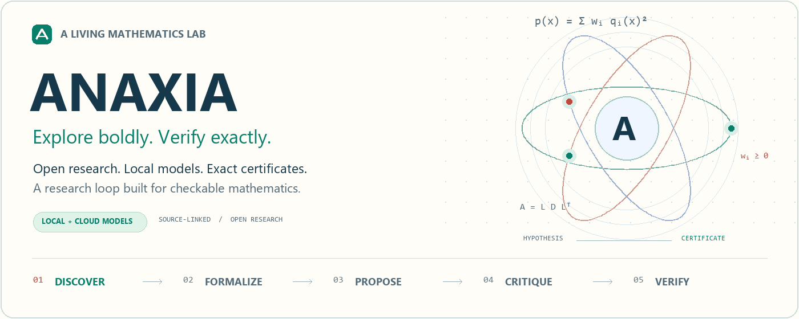

# Anaxia Research

**Reproducible proof artifacts and a methods-report draft for local-model mathematical research.**

This companion to [Anaxia](https://github.com/creelie/Anaxia) separates model-generated suggestions, exact computational evidence, and kernel-checked statements. It contains Lean proofs, an independent Julia replication, actual validation records, and an editable research manuscript.

| Artifact | What it establishes |
| --- | --- |
| [Lean certificates](lean/Certificates.lean) | Eight checked theorems: 24 distinct `D4` vectors, exact norms and pair separation, a distance witness, integer squares modulo four, an elementary integer impossibility, and a positive control. |
| [Julia replication](julia/verify.jl) | Independent `BigInt`/rational calculations for the known `D4` construction, SOS coefficient identity, a tampered identity, a rational counterexample, and modular residue tables. |
| [GitHub verification record](reports/ci-validation.json) · [Local Lean run](reports/validation.json) | Runtime status, source hashes, theorem count, and printed axiom dependencies. |
| [Methods manuscript](paper/manuscript.md) · [LaTeX](paper/manuscript.tex) · [PDF](paper/manuscript.pdf) | An editable methods draft and compiled copy for author review. |

The mathematical examples are established constructions and elementary facts. The package does not claim a new closure of Hodge, Yang–Mills, the Riemann hypothesis, a reflexive-descent bound, or four-dimensional kissing optimality. See [proof scope](PROOF-SCOPE.md) and [source attribution](DATA.md).

## Reproduce the proofs

Use an already installed Lean 4.34.1 toolchain:

```sh
lean +leanprover/lean4:v4.34.1 lean/Certificates.lean
```

Run the independent Julia checks with Julia 1.10+:

```sh
julia --startup-file=no julia/verify.jl --output reports/julia-verification.toml
```

To capture both execution logs and source hashes with Python 3.11+:

```sh
python scripts/validate.py --lean PATH_TO_INSTALLED_LEAN --julia PATH_TO_INSTALLED_JULIA --require-julia
```

The validator does not install runtimes or download mathematical libraries. The CI workflow sets up Lean 4.34.1 and Julia 1.10, runs both checks, and retains execution records as workflow artifacts. It has push, pull-request, and manual triggers; it has no release or publication step.

## Current recorded validation

The local Lean run passed all eight theorem checks. Six printed no axiom dependencies; the two modular theorems use Lean's standard `propext` and `Quot.sound`. There are no added axioms, proof placeholders, unsafe declarations, or native-computation proof shortcuts.

Julia 1.10.13 passed all 17 assertions on GitHub, where Lean also checked all eight theorems. The saved [Julia report](reports/julia-verification.toml) includes the exact distance histogram, modular residue set, and polynomial controls. [Successful verification run](https://github.com/creelie/Anaxia-Research/actions/runs/43609560559).

Companion snapshots retain the [finite challenge outcomes](reports/companion-challenges.json) and [local model smoke checks](reports/companion-runtime.json) used in the methods draft. A successful deterministic baseline and a working model connection are recorded separately; the smoke run did not supply an additional accepted model certificate.

## Manuscript status

The manuscript is a **methods/software draft for human review**. The author's affiliation, correspondence details, disclosures, and final submission choices require completion. The [submission checklist](submission-checklist.md) identifies the remaining editorial work. No Preprints.org upload, GitHub release, Zenodo deposit, or new DOI registration has been performed.

Maintainer and draft author: **Deep Bhattacharjee**. Preparation was assisted by an AI coding assistant; the author must review and take responsibility for the final work. Project software is MIT licensed. Third-party results keep their original attribution.
